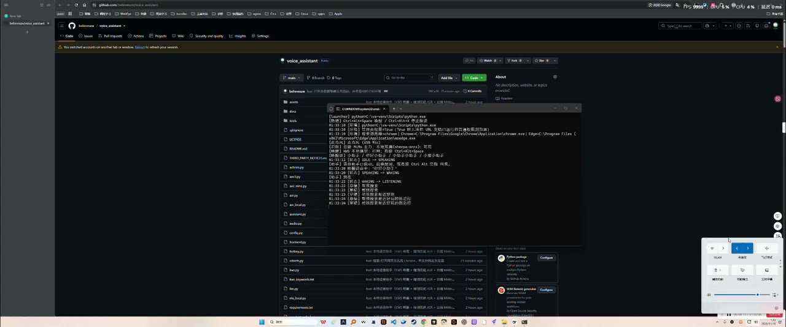

# 语音助手（控制电脑）

一个跑在 Windows 上的中文语音助手：唤醒后可以用语音控制电脑的常用操作（音量、应用、
截屏、锁屏、剪贴板、搜索……），也支持连续对话和闲聊；播报过程中可以直接插话打断。

[](https://github.com/believeszw/voice_assistant/actions/workflows/ci.yml)
[](https://www.python.org/downloads/)
[](LICENSE)
[](https://github.com/astral-sh/ruff)

## 演示视频

[▶ 点击播放 57 秒演示视频](https://media.githubusercontent.com/media/believeszw/voice_assistant/main/docs/media/demo.mp4)

[](https://media.githubusercontent.com/media/believeszw/voice_assistant/main/docs/media/demo.mp4)

一次完整演示：唤醒 → 问时间 → 一句话多指令（打开记事本 + 调音量）→ 播报中插话打断 → 浏览器搜索 / LLM 闲聊。
视频为 **1920×802 原始录屏（13.8 MB，未二次压缩）**，终端里的每行日志都清晰可读。
视频文件 `docs/media/demo.mp4` 由 **Git LFS** 托管：clone 后如果看到的是 LFS 指针文本，执行 `git lfs install && git lfs pull` 拉取视频。

```
麦克风 ──► 前端（AEC 去回声 + Silero VAD）──► 识别（端侧双遍 → 云端兜底 → Vosk 最后兜底）
                                                      │
                                    ┌─────────────────┴───────────────┐
                                    ▼                                 ▼
                            规则意图（本地、快）              云端 LLM（兜底理解 + 闲聊）
                                    └─────────────────┬───────────────┘
                                                      ▼
                                              执行动作（actions.py）
                                                      │
                                                      ▼
                                  播报（云端 MiMo TTS，失败退 SAPI）
```

端侧优先（参照小米车机助手的做法）：唤醒词匹配、VAD、AEC、识别、规则意图都在本地；
云端只在「本地没听清」或「本地文本解析不出意图」时兜底，以及闲聊/知识问答。
说话过程中流式 Paraformer 出草稿（首字约 0.03 s），说完后再用 SenseVoice 对整句纠正。

## 快速开始

```bash
# 依赖（用 DSH 自带 Python）
python -m pip install -r requirements.txt

# 首次需要下载中文识别模型（约 44 MB）
#   https://alphacephei.com/vosk/models/vosk-model-small-cn-0.22.zip
#   解压到 models/vosk-model-small-cn-0.22/

# 语音模式 / 文字模式
python assistant.py
python assistant.py --text
```

`启动语音助手.bat` / `文字模式.bat` 是等价的双击入口。
`--dry-run` 只打印将要执行的动作，不真的操作系统；`--no-wake` 跳过唤醒词；`--no-hotkey` 不注册全局热键。

云端能力（小米 MiMo：ASR / TTS / 意图理解 / 闲聊）需要 key，按以下顺序读取：

1. 环境变量 `XIAOMI_API_KEY`（或 `MIMO_API_KEY`）；
2. `~/.dsh/.credentials.yaml` 里的 `XIAOMI_API_KEY`。

没配 key 也能跑：自动退化为本地 Vosk 识别 + 规则意图 + SAPI 播报（能力弱一些）。
`VOICE_OFFLINE=1` 可强制离线模式。

## 开发与测试

```bash
python -m pip install -r requirements.txt -r requirements-dev.txt

python -m ruff check .                 # 风格/静态检查（核心模块 + tests）
python -m ruff format --check .        # 格式检查；提交前 `python -m ruff format .` 统一格式
python -m pytest -m "not audio"        # 纯逻辑用例，无需声卡（CI 跑的也是这组）
python -m pytest                       # Windows + 音频依赖就位时跑全量
tools\run_regress.bat                  # 本机声学/端到端回归（AEC、唤醒、打断、复合指令）
```

- 设计说明、重构记录与已知差距见 [docs/代码审查报告.md](docs/代码审查报告.md)。
- CI 配置在 [.github/workflows/ci.yml](.github/workflows/ci.yml)：push / PR 时跑 `ruff check .`、`ruff format --check .`、`pytest -m "not audio"`。
- 指令解析是**规则表驱动**（`intents.py` 的 `RULES` 按顺序命中）：新增说法时，
  同时补 `tests/test_intents.py` 的 golden 用例，保证旧说法不回归。详见 [CONTRIBUTING.md](CONTRIBUTING.md)。
- 测试分层：`tests/` 里是不依赖声卡的逻辑用例；`tools/` 下是验收/诊断脚本（不进 CI，也
  不做风格强制），涉及音频链路的改动请在 PR 里贴 `tools/run_regress.bat` / `tools/demo_e2e.py`
  的输出。


- 唤醒词：`小助手` / `你好小助手` / `小助手小助手` / `小爱小助手`，或热键 `Ctrl+Alt+Space`。
- 一次唤醒可连续说多轮（默认最多 6 轮，静音超过 6 秒自动退出；说“结束/退出”主动结束）。
- 播报中直接说话即可**打断**（AEC 负责把自己的声音滤掉，避免自问自答）。
- 热键 `Ctrl+Alt+X` 停止朗读。
- 常用指令示例：
  - “打开记事本”“打开 B 站”“关闭计算器”
  - “打开桌面的新建文本”“打开下载文件夹”（`打开<文件夹>的<文件名>` 会按精确/前缀/包含顺序匹配文件）
  - “用谷歌浏览器搜索附近好玩的”“用 edge 搜索天气”“打开谷歌浏览器搜索特斯拉”（默认用 Chrome，可在 `config.SEARCH_BROWSER` 改为 edge/default）
  - “音量调到五十”“声音大一点”“静音”
  - “截个屏”“锁屏”“显示桌面”“现在几点”
  - “搜一下明天的天气”“复制今天下午三点开会”“内存还剩多少”
  - “今天吃啥”“讲个笑话”（走云端闲聊）
- 关机/重启/睡眠/关应用/锁屏等危险动作会二次确认。

## 目录

| 文件 | 作用 |
| --- | --- |
| `assistant.py` | 主程序：唤醒、会话状态机、指令分发、播报与打断 |
| `config.py` | 常量：采样率、唤醒词、应用别名、危险动作、会话参数 |
| `audio.py` | 麦克风采集、能量 VAD、录音 |
| `asr.py` | Vosk 本地识别（流式/整段，最后兜底） |
| `asr_local.py` | 端侧双遍识别：流式 Paraformer + 句尾 SenseVoice 校正 |
| `llm.py` | 小米 MiMo：云端 ASR / TTS / 意图理解 / 闲聊 |
| `tts.py` | 播报双路：云端 TTS → 端侧 Piper/VITS → SAPI；播放参考 PCM 喂 AEC |
| `tts_local.py` | 端侧 TTS：Piper（首选）/ sherpa-onnx VITS（兜底），流式 PCM + 整段 wav |
| `nlu_local.py` | 端侧 NLU：llama.cpp + Qwen2.5-1.5B，json_schema function calling + 白名单/槽位校验 |
| `frontend.py` | 前端：AEC（回声抑制）+ Silero VAD + 降噪（NS）+ 自动增益（AGC）+ 打断判定 |
| `aec3.py` | WebRTC AEC3 的 ctypes 绑定（首选 AEC 引擎，10 ms 帧） |
| `aec_nlms.py` | 轻量 AEC 兜底：延迟锁定 + 最小二乘增益 + 双讲检测 |
| `intents.py` | 规则意图解析（快、离线可用） |
| `text_utils.py` | 纯文本工具：噪声过滤、口头词剥离、复合指令拆分、等待时间解析（不依赖音频，可独立单测） |
| `actions.py` | 具体电脑操作（音量、应用、截屏、剪贴板、系统操作……） |
| `hotkey.py` | 全局热键 |
| `kws.py` | 本地唤醒词：sherpa-onnx 专用 KWS 模型 |
| `kws_keywords.txt` | 唤醒词注册表（拼音声母/韵母 + 声调） |
| `assets/wake_ack.wav` | 预生成的唤醒回应「我在」，唤醒时直接播、不等云端合成 |
| `tools/` | 自测与验收脚本（诊断用，不参与 CI） |
| `tests/` | pytest 用例：golden 指令语料 + 纯逻辑辅助函数 |
| `pyproject.toml` | 打包与工具配置（ruff / pytest 标记） |
| `CONTRIBUTING.md` | 贡献指南：环境、检查命令、规则表约定 |

## 验收数据（第 1、2 步：AEC + VAD + 打断）

离线合成回声场景（`tools/test_frontend.py`；回声延迟 80 ms、衰减 0.35，1.6 s 处按近场电平
（×3.0）叠加用户语音）：

| 指标 | 目标 | 实测（AEC3 引擎） |
| --- | --- | --- |
| ERLE（回声抑制） | ≥ 6 dB | **38.2 dB** |
| 双讲段用户检出率 | ≥ 80% | **85.0%** |
| 纯回声段误触发 | ≤ 20% | **0%** |
| 打断延迟 | ≤ 0.6 s | **0.25 s** |

真实声学闭环（`tools/test_barge_real.py`：扬声器放播报、麦克风收回声，用户声按近场叠加）：
相对用户开口 **+0.03 ~ +0.10 s** 触发打断，真实回声路径 ERLE ≈ **16.8 dB**。

假麦克风集成测试（`tools/test_barge.py`）：播报中被打断，状态机 `IDLE → SPEAKING →
INTERRUPTED` 正确，`speaker.stopped=True`。

## 车机可用标准：WebRTC AEC3 集成（第 6 步）

为达到「车机可用」标准，把自研 FLMS AEC 换成 WebRTC 官方 AEC3（webrtc-audio-processing v2.1）。

### 构建与产物

- 源码 webrtc-audio-processing v2.1 放在 `C:\wap2\src`（短路径，规避 MSVC 长路径 C1083）；abseil 由 meson subproject 自动编译。
- 构建链：`vcvars64.bat` → `meson setup build --backend ninja --buildtype release -Dcpp_std=c++20` → `meson compile -C build`。必须 C++20（源码用 designated initializers，否则报 C7555）。
- C ABI 包装：`C:\wap2\wrap\aec3_wrap.cpp`，导出 `wap_create / wap_destroy / wap_frame_size / wap_process_far / wap_process_near / wap_set_stream_delay`，链接 `webrtc-audio-processing-2.lib`。
- 运行所需 DLL 已随项目放在 `tools/aec3/`：`aec3_wrap.dll`、`webrtc-audio-processing-2-1.dll`。

### 接入与降级

- `aec3.py`：ctypes 绑定，只支持 10 ms 帧（160 样本 @16 kHz）、float[-1,1]，属性 `delay / dtd / erle`。
- `frontend.py` 的 `_make_aec()` 按 `config.AEC_ENGINE` 选择：`auto`（默认，优先 AEC3，加载失败退 FLMS）/ `aec3` / `flms`。
- DLL 缺失或加载异常时自动退回 `aec_nlms.py`（FLMS），接口一致，上层不用改。

### 验收

| 场景 | 结果 |
| --- | --- |
| 离线双讲（`tools/test_frontend.py`，AEC3） | ERLE 38.2 dB、hit 85.0%、fp 0%、latency 0.25 s，PASS |
| 真实近场打断（`tools/test_barge_real.py`） | +0.10 s 触发，真实回声 ERLE 16.8 dB，PASS |
| AEC3 单测（`tools/test_aec3.py`） | ERLE 20.0 dB（含用户语音的双讲段），PASS |
| SAPI 本地播放暂停（`tools/test_tts_local.py`） | `pause=True`、第二句可朗读，PASS（SAPI 同步渲染整句，首次约 1 s） |

```bash
python tools/test_aec3.py        # AEC3 单测：ERLE
python tools/test_frontend.py    # 离线双讲验收（ERLE / hit / fp / 打断延迟）
python tools/test_tts_local.py   # 断网时 SAPI 渲染 wav 播放（可暂停）
```

### SAPI 播放现在可暂停

本地兜底不再直接 `SAPI.Speak`：先用 `SpFileStream` 渲染成 wav（`_sapi_render_wav`）再走可暂停的 `_play_wav`。因此断网 / 云端失败时也能暂停、继续、推 AEC 参考与缓存。

## 验收数据（第 3 步：sherpa-onnx 双遍 ASR）

模型（放在 `models/` 下）：

- 流式 Paraformer：`sherpa-onnx-streaming-paraformer-bilingual-zh-en/`（encoder.int8.onnx 165 MB + decoder.int8.onnx 72 MB + tokens.txt）
- SenseVoice：`sherpa-onnx-sense-voice-zh-en-ja-ko-yue-2024-07-17/`（model.int8.onnx 239 MB + tokens.txt）
- 下载：`tools/dl_models.py`（走 HuggingFace 镜像，单文件断点续传）

测试集：`tools/wav/case_*.wav` 是 12 条 SAPI 合成指令；`tools/make_farfield.py` 在其上叠加
60 ms 早期反射 + 白噪声，生成 SNR=10 dB / 5 dB 两套受控远场集。数字是 12 条的平均 CER：

| 引擎 | 干净合成 | SNR 10 dB | SNR 5 dB |
| --- | --- | --- | --- |
| Vosk small-cn（旧兜底） | 0.000 | 0.431 | 0.444 |
| 流式 Paraformer | 0.000 | 0.074 | 0.219 |
| SenseVoice 整句 | 0.000 | 0.083 | 0.117 |
| **端侧双遍（线上路径）** | **0.000** | **0.083** | **0.083** |
| 云端 MiMo ASR | 0.000 | 0.083 | 0.042 |

延迟（端侧、本机 CPU、num_threads=2）：

| 指标 | 实测 |
| --- | --- |
| 流式首字延迟 | **0.019 ~ 0.029 s** |
| 双遍首字延迟 | **0.023 ~ 0.029 s** |
| 双遍句尾总耗时 | **0.106 ~ 0.150 s** |
| SenseVoice 整句耗时 | **0.040 ~ 0.055 s** |

结论：噪声下 Vosk 小模型基本不可用（CER 0.43~0.44），端侧双遍把 CER 压到 0.08；
云端仍最准（5 dB 时 0.042），离线/弱网时端侧双遍能独立顶住。

```bash
# 复现验收（干净 / 受控远场 / 云端对照）
python tools/test_sherpa.py
python tools/test_sherpa.py --dir farwav_10db
python tools/test_sherpa.py --dir farwav_5db --cloud
```

关于真实麦克风：本机扬声器是 HDMI 显示器自带音箱、离麦克风很远，`tools/record_micset.py`
录到的语音只有 rms≈200（底噪几乎为 0），归一化后各引擎 CER 仍在 0.6~1.0 —— 是物理声学路径太弱，
不是模型问题；量产设备上靠 AGC/近场麦克风解决。

## 端侧优先策略（云端为辅）

决策顺序（`assistant._asr`）：

1. 端侧双遍识别先出结果；
2. 结果 ≥2 字且能解析出意图 → **直接执行，不联网**；
3. 本地为空/太短 → 云端 ASR 兜底；
4. 本地有字但规则解析不出意图 → 云端重听一次，**只有云端文本也能解析出明确意图时才采纳**（避免极低信噪比下云端更差）。

四个数据集上的策略效果（12 条指令，`tools/test_policy.py`）：

| 数据集 | 端侧 CER | 策略后 CER | 云端重听触发 | 端侧句尾耗时 |
| --- | --- | --- | --- | --- |
| 干净合成 | 0.000 | 0.000 | 1/12 | 71–75 ms |
| SNR 10 dB | 0.083 | 0.083 | 2/12 | 70–73 ms |
| SNR 5 dB | 0.083 | **0.000** | 2/12 | 71–77 ms |
| SNR 0 dB | 0.249 | **0.221** | 5/12 | 73–76 ms |

云端重听单次约 470–580 ms，只发生在本地把握不足的那 1–5 条上；其余指令全程本地完成。

```bash
python tools/test_policy.py              # 纯端侧（相当于断网）
python tools/test_policy.py --with-cloud # 端侧优先 + 云端兜底
```

开关（`config.py`）：`ASR_LOCAL_FIRST` / `ASR_CLOUD_FALLBACK` / `ASR_CLOUD_RETRY_ON_UNKNOWN` / `ASR_LOCAL_MIN_CHARS`。
`VOICE_OFFLINE=1` 可强制全离线（唤醒、识别、意图、播报全走本地）——已验证 12/12 条常用指令端侧可完成。

播报是这条链路里唯一默认走云端的环节：云端 TTS 音质好、而且它的播放 PCM 正好给 AEC 当参考信号；
网络不可用时自动退 SAPI 本地发音。

## 验收数据（第 4 步：本地 KWS 唤醒词）

唤醒不再靠通用识别模型匹配「小助手」三个字，改用 sherpa-onnx 的专用关键词模型：

- 模型：`sherpa-onnx-kws-zipformer-wenetspeech-3.3M-2024-01-01-mobile`（encoder 3 MB int8，
  解压后整个目录约 15 MB），来源 GitHub `k2-fsa/sherpa-onnx` 的 `kws-models` release；
- 关键词：`kws_keywords.txt`，按声母/韵母+声调注册，例如 `x iǎo zh ù sh ǒu @小助手`；
- 默认 `threshold=0.25, score=1.0`；单核实时率约 1%，常驻几乎不占 CPU。

测试集：4 个唤醒词 × 3 种语速（SAPI 合成，12 条正样本）；负样本为 12 条不含唤醒词的
指令音频 + 30 s 白噪声 + 30 s 静音。

| 条件 | 唤醒率 | 平均触发位置（相对音频结束，负=提前） | 误唤醒 |
| --- | --- | --- | --- |
| 干净 | **100%** | -0.55 s | — |
| SNR 10 dB | 75% | -0.69 s | — |
| SNR 5 dB | 83% | -0.65 s | — |
| SNR 0 dB | 58% | -0.78 s | — |
| 负样本（13 min） | — | — | **0 次（约 0 次/小时）** |

触发位置为负说明流式 KWS 在唤醒词还没播完时就已命中，用户说完「小助手」到助手应答之间
不需要再等整段音频结束；实战中从说出唤醒词到进入对话约 0.5 s。

端到端自测（主线程、不需要真麦克风）：

- `python tools/test_wake.py`：KWS 命中「你好小助手」→ 会话里执行「现在几点了」→「退出」；
- `python tools/test_wake2.py`：走真实 `run_voice()`（只把麦克风换成回放），验证
  「唤醒 → 多轮会话 → 退出」整条胶水，PASS。

（sherpa-onnx / onnxruntime 在非主线程加载模型会 abort，所以这些测试都在主线程里跑；
生产入口 `python assistant.py` 本身就在主线程，不受影响。）

```bash
python tools/test_kws.py            # 唤醒率 / 误唤醒 / 实时率
python tools/test_kws.py --sweep    # 扫 threshold / score 选参数（会打印推荐组合）
```

行为：KWS 命中即进入会话；「小助手，现在几点了」这类一句话带指令的，仍由 Vosk 文本匹配
兜底解析出后半句直接执行。

## 验收数据（第 5 步：降噪 NS + 自动增益 AGC）

补齐选型文档里 `AEC → NS → AGC` 缺的两环，实现在 `frontend.py`：

- `NoiseSuppressor`：过减谱减（256 点 / hop 128，20 ms 帧、10 ms 步进，hann 窗 50% 重叠 OLA，
  固有延迟 128 样本 ≈ 8 ms），噪声估计「像噪声的帧快跟、像语音的帧慢跟」；
- `AGC`：目标 RMS 0.05，压得快（0.5/0.5）、放得慢（0.75/0.25），峰值限 0.98；
- 双档参数：**唤醒链路**用语音保护档（`speech_floor=0.35`，过减时不削 0 dB 唤醒词），
  **ASR 前处理**用深降噪档（`oversub=3.4`、`floor=0.03`，配 AGC），由 `enhance_pcm()` 提供。
- 接入位置：唤醒循环 `fe.process(block, enhanced=True)` 的输出喂 KWS / Vosk 文本兜底；
  会话录音后 `enhance_pcm(pcm)` 的结果用于云端 ASR 与云端重听（端侧双遍仍在原始流上跑）。

验收脚本 `tools/test_ns_agc.py`（PASS）：

| 项 | 条件 | 结果 |
| --- | --- | --- |
| AGC 电平拉齐 | 峰值 0.02 / 0.08 / 0.30 输入 | 输出峰值 0.23 / 0.55 / 0.93，误差 ≤ 8 dB，**PASS** |
| NS 识别（SenseVoice CER） | SNR 10 / 5 / 0 dB | 0.167→0.167、0.167→0.167、0.200→0.200（未变差），**PASS** |
| NS 唤醒（KWS 命中） | SNR 5 / 0 dB | 3/4→3/4、2/4→2/4（未变差），**PASS** |
| 降噪量（纯噪声输入） | 目标 ≥ 10 dB | -34.0 dBFS → -44.9 dBFS，**10.9 dB**，**PASS** |

```bash
python tools/test_ns_agc.py     # AGC 电平、NS 前后 CER、NS 前后唤醒、纯噪声降噪量
```

## 体验优化：打断（barge-in）与唤醒回应

这一轮专门改「插话打断」和「唤醒回应慢」两个体感问题。

### 两段式打断：先暂停，再确认

- 旧逻辑：能量一超阈值就 `speaker.stop()`。本机扬声器漏音（rms 0.02–0.03）会被当成用户开口，
  12 s 播报里误打断 5 次。
- 新逻辑（`assistant.py`）：
  1. 判定潜在打断 → `speaker.pause()`（云端播放可暂停；SAPI 直接丢弃重建）；
  2. 0.55 s 内直接读麦克风做能量确认（`loud>=3` 块或 `very_loud>=1` 块）；
  3. 真打断 → `speaker.discard()`，记录 `_pre_pcm`；假打断 → `speaker.resume()` 继续播，不丢句。
- 阈值（`frontend.py`）：`base=max(0.003, p25(clean))`（不再用 1e-4 地板）、`ratio` 封顶 99、
  `ratio_ev = ratio>8 且 rms>0.04`、`loud_ev = rms>0.10`、`strong_ev = ratio>20 且 rms>0.05`，
  开头 0.5 s 不判打断。

### 预录回捞：不切掉第一句的头

- 前端环形缓冲保留最近 3 s 的 clean / near（`fe.recent_clean()` / `fe.recent_near()`）；
- 确认打断后取 **1.2 s 预录 + 确认窗口录音（0.55 s）+ 0.45 s 后续**，按时间顺序拼好，作为
  下一轮 `record_utterance(pre_pcm=...)` 的开头，直接续录到静音结束，首字不再丢。
- 这里修过一个 bug：早期版本「暂停→确认」那 0.55 s 的麦克风数据被丢掉了，用户在确认窗口里
  说的话会整段消失（表现为打断后识别为空）；现在 `_confirm_barge()` 会把这段 PCM 一起返回并拼进去。
  实测预录总长 2.20 s，Vosk 对预录音频能识别出内容。

### 唤醒「我在」更快

- 唤醒回应不再等云端 TTS：预生成 `assets/wake_ack.wav`（约 1.0 s 音频，一次生成），
  唤醒时直接播放；实测唤醒回应 1.19 s（其中 1.0 s 是音频本身；旧 SAPI 路径 1.33 s，
  云端路径还要先等约 1.1 s 合成）。

### 验收数据

| 场景 | 结果 |
| --- | --- |
| 离线双讲（`tools/test_frontend.py`，AEC3） | ERLE 38.2 dB、hit 85.0%、fp 0%、打断延迟 0.25 s，PASS |
| 合成打断（`tools/test_barge_ux.py`） | 5/5 场景 PASS：检测延迟 0.20–0.30 s、预录 0.50 s、纯播报 6 s 误打断 0 |
| 真实误打断（`tools/test_barge_false.py`，11.55 s 播报、无人说话） | **0 次**（修复前 5 次）；唤醒回应 1.19 s |
| 真实近场打断（`tools/test_barge_real.py`） | 相对用户开口 +0.10 s，真实回声 ERLE 16.8 dB，PASS |
| 假麦克风集成（`tools/test_barge.py`） | 播报 2.93 s 被打断，`stopped=True`，`INTERRUPTED`，PASS |
| 打断预录（`tools/test_barge.py`） | 预录 **2.20 s**（含确认窗口音频），Vosk 对预录可识别出内容，PASS |
| 多轮会话回归（`tools/test_wake2.py`） | 唤醒 →「我在」→「现在几点了」→「退出」PASS |
| 演示体验回归（`tools/test_demo_fixes.py`） | 唤醒词残余文本过滤、噪声短语过滤、停止播报尾音不误确认，PASS |

### 演示日志暴露的三个问题（已修）

真机演示时遇到的三类问题，根因都在「把不该当输入的东西当成了输入」：

1. **唤醒被识别成「你好小姐」，剩下的「姐」被当指令执行**：Vosk 文本匹配唤醒分支会把整句
   唤醒结果里的残余文本直接当第一句指令。现在 `_strip_wake()` 剥掉唤醒词后，
   剩余内容 ≤1 个字或命中口头词表（`_NOISE_WORDS`：yeah/ok/嗯/啊…）就丢弃，不进会话。
2. **噪声被识别成「Yeah。」，当闲聊指令白吃一轮**：`_is_noise()` 在会话循环里过滤，
   命中就记 `[噪声] 忽略` 并把这一轮让回去（不消耗 6 轮额度）。
3. **播报中被打断后会话直接结束**：打断确认窗口里收进来的其实还有播放尾音，且旧逻辑把
   被打断的那一轮算作已用额度。现在 `_confirm_barge()` 先 `mic.flush()` 并丢弃前 0.20 s
   播放尾音再判断；`_session()` 在 `self._interrupted` 时 `continue`，不消耗轮次
   （`rounds` 上限防死循环）。

验证：`python tools/test_demo_fixes.py`（全部 PASS）；配合 `test_barge_false.py` 0 误打断、
`test_wake2.py` 多轮会话回归。

```bash
python tools/test_barge_ux.py      # 合成双讲：检测延迟 / 预录 / 纯播报误打断
python tools/test_barge_real.py    # 真实扬声器 + 麦克风，近场注入用户声
python tools/test_barge_false.py   # 真实播报 12 s 无人说话，验证 0 误打断
python tools/test_compound.py      # 一句话多指令（复合指令）
python tools/test_frontend.py      # AEC + VAD + 打断离线验收
```

## 连续对话与一句话多指令

对标小米车机助手的两种「连续说」能力：

1. **一次唤醒、多轮连续对话**：唤醒后最多 6 轮，每轮之间不用再说唤醒词；
   静音 6 s 或说「结束 / 退出 / 再见」结束。
2. **一句话多个指令**：说「打开记事本，然后调大音量」「静音，再显示桌面」，
   助手会按顺序执行并一次性汇报。支持的分隔词：`，` `；` `然后` `接着` `并且` `再`。

实现（`assistant.py`）：`split_compound()` 先拆子句，各子句都能被规则意图解析时逐条执行、
回复用「；」拼起来；只要有一句解析不了，就退回原来的单指令 + 云端 LLM 理解路径。

```bash
python tools/test_compound.py      # 复合指令验收（5/5 PASS）
```

## 验收数据（第 7 步：双路 TTS——云端 MiMo + 端侧 Piper）

选型 §5 要求「云端 TTS 超时/断网 → 端侧立即读」。本机实测云端 MiMo TTS 整段往返
P50=1545 ms（10 句，1.42–2.61 s，含网络 + 整句合成），弱网/隧道场景不可用；端侧 Piper
整句只要 24–74 ms，因此做成双路：**云端优先、端侧兜底、SAPI 保底**。

实现：

- `tts.py` 路由：`TTS_LOCAL_FIRST=1` 时直接走端侧；默认先云端（`llm.tts_wav` 受
  `TTS_CLOUD_TIMEOUT=4.0 s` 约束），异常/超时/空音频自动降级端侧，日志
  `[TTS] 云端合成失败/超时，改用端侧: <原因>`；端侧再失败才退 SAPI。
- `tts_local.py`：Piper（`zh_CN-huayan-medium`，22050 Hz VITS）为首选端侧后端，
  sherpa-onnx VITS（MeloTTS）为兜底；`TTS_LOCAL_BACKEND=piper|vits` 可强制指定。
  对外 `synth_wav()` 整段 wav、`stream()` 逐块 int16 PCM（为后续「边合成边播」预留）。
- 播放继续复用 `_play_wav`：50 ms 分块写声卡、可暂停/打断、把实际播放的参考 PCM 按
  输出延迟推给 AEC——双路切换不改变打断和回声抑制行为。

数据（`tools/test_tts_local.py`、`tools/test_tts_asr_roundtrip.py`、`tools/test_cloud_tts_roundtrip.py`）：

| 指标 | 云端 MiMo（冰糖） | 端侧 Piper | 端侧 sherpa VITS（MeloTTS） |
| --- | --- | --- | --- |
| 整句合成 | 往返 P50 1545 ms | P50 37 ms（24–74） | 1003–2905 ms（RTF≈1.2） |
| 首包 | 需整段返回 | 首块 29–42 ms | 整句合成完才有 |
| 采样率 | 24 kHz | 22.05 kHz | 44.1 kHz |
| 回环 CER（10 句） | 0.144 | **0.042** | 0.092 |
| 常驻内存 | — | ~170 MB | ~250 MB |

- Piper 首次播报懒加载模型 1.6–1.7 s，之后单句 24–74 ms；`TTS_LOCAL_BACKEND` 对比实测：
  MeloTTS 音色更自然但 CPU 上 RTF≈1.2，整句 1–3 s，只适合做兜底。
- 可懂度回环 = TTS 合成 → SenseVoice int8 识别 → 字符 CER。云端那一例 0.144 里，
  8/10 完全正确，「已打开记事本」被合成为「给他台记事本」——MiMo ASR 与 SenseVoice
  两端都听成一样，确认是云端合成发音问题，不是识别问题。
- 结论：端侧 Piper 满足选型 §2「端侧 TTS 首包 +100–200 ms」预算（实测首块 <50 ms），
  可懂度最好；云端只在音色自然度优先且网络好时使用。

## 验收数据（第 8 步：端侧 NLU——function calling 本地兜底）

背景：`intents.py` 规则解析零延迟、离线可用，但只覆盖固定说法（「现在这个点儿了」
「把浏览器给我整出来」这类长尾会掉 unknown）；云端 LLM 理解又依赖网络。因此加一层
端侧 function calling：**云端 LLM 优先 → 端侧 Qwen2.5-1.5B → 规则/兜底话术**。

实现：

- `nlu_local.py`：本地 llama.cpp `llama-server` 加载 Qwen2.5-1.5B-Instruct Q4_K_M
  （`models/llm/qwen2.5-1.5b-instruct-q4_k_m.gguf`，1.1 GB）；按 `llm.ACTIONS` 生成
  30 个工具 schema，用 `response_format=json_schema(strict)` 约束输出
  `{action, name?, value?, text?, term?, url?}`。
- 服务按需拉起：首次用到时 `subprocess.Popen(tools/llama/llama-server.exe --port 18080
  -c 2048 --log-disable)`，等 `/health`（0.93–0.95 s）；进程退出时 atexit 关掉，
  日志 `tools/_llama_server.log`。缺模型/缺二进制时自动跳过端侧 NLU，原链路不受影响。
- 安全校验 `validate()`：动作白名单（`llm.ACTIONS`）+ 槽位钳制（音量 0–100、url 补
  scheme、应用名走 `config.APPS/FOLDERS` 别名）+ 语义护栏（正文必须提到音量/声音/喇叭/
  静音等，才允许 volume 类动作，防 1.5B 把「空调开到二十四度」套成 `volume_set`）。
  校验不过按「没听懂」处理，交回规则/云端/兜底话术。
- 接入点 `assistant.py:393-414 _llm_understand()`：云端 LLM（可用时）→ 端侧 NLU
  （`NLU_LOCAL_ENABLED` 且可用）→ 返回 None。命中端侧时日志
  `[NLU] 端侧 json_schema 229ms prompt=49 gen=`。

数据（`tools/test_nlu_local.py`，20 条 = 指令 + 长尾 + 易误判的空调温度类）：

- json_schema 模式：**20/20 通过**；P50=206 ms、P95=max=840 ms（首条 831 ms 含
  prompt 处理，暖机后 150–360 ms；集成实测「现在这个点儿了」703→229 ms）。
- llama-server 常驻 RSS ≈1.8 GB（1.5B Q4 + 2048 ctx KV），符合选型 §4
  「1.5B int4 1.5–2.5 GB」。
- 可选 `tools/tool_calls` 模式：当前 20 条全部 HTTP 400（llama-server 需额外开
  `--jinja` 才接受原生 tools 参数），默认已改用 json_schema；
  `NLU_LOCAL_TOOL_CALLS=1` 预留切换开关。
- 端到端（`tools/test_assistant_integration.py`：子进程跑真实 `assistant.py --text
  --no-hotkey`，stdin 喂指令）：
  - **offline**（`VOICE_OFFLINE=1`）：规则 time、端侧 NLU 兜底 time、规则 volume_set、
    volume_down / volume_set 全部正确；端侧 TTS 播报 6 次、端侧 NLU 解析 3 次；
    总耗时 10.6 s；峰值 RSS 2126 MB（含 llama-server）。
  - **degrade**（把 `XIAOMI_API_KEY` 设成无效值，模拟云端挂）：每次播报都命中
    `[TTS] 云端合成失败/超时，改用端侧: 401 Client Error` 并由 Piper 成功接住（4/4）；
    长尾指令走端侧 NLU（703 ms 冷启 / 229 ms 暖机）；总耗时 17.4 s；峰值 RSS 2083 MB。

## 演示脚本（面试/展示用）

建议按下面顺序演示，覆盖「多轮 + 多指令 + 打断 + 离线 + 闲聊」：

| 顺序 | 你做什么 | 展示什么 |
| --- | --- | --- |
| 1 | 「你好小助手」→「现在几点了」 | 本地 KWS 唤醒 + 端侧识别 + 规则执行 |
| 2 | 接着说「把音量调到三十」→「静音」 | 一次唤醒多轮，不用重复唤醒词 |
| 3 | 「打开记事本，然后调大音量」 | 一句话多指令、按顺序执行 |
| 4 | 让助手念一段长回复（例如问「讲个笑话」），念到一半插话「停一下，现在几点了」 | 打断 + 确认不是噪声 + 接住被打断的话 |
| 5 | 断网或 `VOICE_OFFLINE=1` 跑一遍 `文字模式.bat` | 端侧优先：KWS/识别/规则全本地，云端只兜底 |
| 6 | 「关机」→ 助手二次确认 → 说「取消」 | 危险操作白名单 + 二次确认 |
| 7 | 「讲个笑话」「今天天气怎么样」 | 云端 LLM 闲聊（车机式问答） |

一句提醒：演示前先双击 `启动语音助手.bat`，等看到「KWS 本地模型: 可用」再开始；
系统音量保持 60% 以上，麦克风离嘴 30–50 cm 效果最好。

已知限制：预录回捞最多 2.2 s（1.2 s 环形预录 + 0.55 s 确认窗口 + 0.45 s 补录）；SAPI 已改为先渲染 wav 再播放，可暂停。

## 已知限制

- AEC：默认用 WebRTC AEC3（`tools/aec3/` 下的 DLL，见上一节）；DLL 缺失时自动退自研 FLMS
  （`aec_nlms.py`，延迟锁定 + 标量增益）。弱回声/远场下 AEC3 的 ERLE 也会下降，此时前端退化为
  “近场能量门限”判打断（`frontend.py` 的 `weak_echo` 分支）。
- 识别顺序：云端 MiMo → 端侧双遍（流式 Paraformer + SenseVoice 校正）→ Vosk 小模型（最后兜底）。
  Vosk 在噪声下基本不可用，只用于极端降级。
- 尚未做：多音区、声源定位；唤醒词 KWS 已用专用模型（见上一节），不再靠 Vosk 文本匹配。
- NS 是经典过减谱减，只压稳态噪声（风扇/空调/机箱底噪），对突发噪声、混响、音乐噪声无能为力；
  量产应换 DeepFilterNet / RNNoise 这类 DNN 降噪，接口已按 `NS + AGC` 留好。
- AGC 只在 ASR 前处理与离线增强里用，唤醒链路不做 AGC（放大底噪会抬误唤醒率）。
- 端侧 NLU（Qwen2.5-1.5B）对极少数长尾仍可能误判；动作白名单 + 槽位钳制 + 音量语义
  护栏已挡掉越权/误套，危险动作仍有二次确认，最坏情况是回一句「这个我还答不上来」。
- 端侧 TTS 双路也缺省走 Piper；Piper 音色不如云端 MiMo 自然，多音字/中英混读场景
  两者各有错例（回环 CER 见第 7 步）。

## 运行环境（重要）

- **用短路径 venv 跑**：`启动语音助手.bat` / `文字模式.bat` 优先用 `C:\va-venv\Scripts\python.exe`，
  其次项目内 `.venv`，最后 DSH python。原因：本机实测，解释器路径在很长的工作区目录下时，
  SAPI / System.Speech 会报「系统上未安装语音」或 `0x80045040`，导致本地兜底 TTS 失效；
  同一个 venv 放到 `C:\va-venv` 就正常。换机器时把依赖装到一个短路径 venv 即可。
- 端侧 TTS 双路：首选 Piper（`piper-tts` 1.8，模型 `models/tts/piper-zh_CN-huayan-medium/`，
  首次播报懒加载 ~1.7 s）；sherpa-onnx VITS（`models/tts/vits-melo-tts-zh_en/`）为次选；
  两者都不可用才退 SAPI——先 `SpFileStream` 渲染 wav（COM，快），失败再退
  `tools/ps_tts.ps1`（System.Speech）。渲染临时文件放项目内 `.tts_tmp/`（不写系统 %TEMP%，
  本机沙箱下可能被拒写），渲染完即删。
- 端侧 NLU：`tools/llama/llama-server.exe` + `models/llm/qwen2.5-1.5b-instruct-q4_k_m.gguf`
  （约 1.1 GB，常驻 RSS ~1.8 GB）；缺模型/缺二进制时自动跳过端侧 NLU，不影响原链路。
- 模型获取脚本（已下载过的可跳过）：`tools/_fetch_gguf.py`（Qwen GGUF，ModelScope）、
  `tools/_fetch_llama.py`（llama.cpp Windows 预编译包，gh-proxy）、
  `tools/_fetch_piper_voice.py`（Piper 中文音色，hf-mirror）、`tools/_fetch_tts.py`（MeloTTS 兜底）。
- 演示前：**重启助手**（旧进程还是旧逻辑），确认系统音量 ≥60%、默认输出设备未静音
  （`python tools/fix_volume.py` 可一键取消静音并拉满）；唤醒回应「我在」说完再开口。


## 真实端到端演示回放（自动自证）

`tools/demo_e2e.py` 把「演示脚本」里的每句话用 SAPI 合成 → 扬声器真实播放 → 麦克风采集 →
真实 `assistant.py --no-hotkey` 子进程处理，最后按助手日志里的 `[动作]` / `[状态]` 行判定通过与否。

```bat
C:\\va-venv\\Scripts\\python.exe tools\demo_e2e.py
```

最近一次结果：**11/11 PASS**（启动、唤醒、时间、音量 30、音量 80、复合指令开记事本+音量 60、
打断播报并接住下一句、云端闲聊、退出）。报告见 `tools/demo_e2e_report.txt`，助手日志
`tools/demo_e2e_assistant.log`。

注意：
- 回放音量需要 `actions.set_volume(100)`；本机扬声器→USB 麦克风路径很弱，demo 里每句话播放前
  都会把系统音量拉回 100（否则「把音量调到三十」之后几句会小声到 ASR 认错）。
- demo 播放用 3 倍增益（实测：1 倍太轻识别不出来，2~6 倍均可）；不要用 6 倍以上，容易削波。
- 这仍然是「机器合成语音」的闭环，不等价于真人说话；真人、口音、环境噪声仍需在本机实际说。

## 测试用例文档

- `docs/语音助手_测试用例.md`：60 条用例（P0 30 条），含前置条件、步骤、预期、自动化脚本与最近结果。
- `docs/语音助手_测试用例.docx` / `.pdf`：同一份内容的 Word / PDF 版，可直接发送或用飞书导入。
- 重新生成：`python tools/build_test_doc.py`（改完用例数据后执行；docx 由 DSH python 的 python-docx 生成）。
- `docs/语音助手_演示脚本.docx` / `.pdf`：演示脚本版（顺序/你说/展示点/通过标准 7 步 + 打断专项），适合面试/评审照着念。
- `docs/代码审查报告.md`：代码质量与风格审查（分层评价、P1–P3 问题清单、修复记录与后续重构路线）。

## 已知限制：单麦听不出「谁在说话」

- 本机用的是单个 USB 麦克风，只能录到一个混合声场：自己播报的回声可以被 AEC 消掉，但**别的应用外放的声音（游戏、视频、电视）消不掉**，会被当成用户说话，触发唤醒/指令/打断。
- 典型现象：演示时后台开着游戏/视频，助手会听到游戏台词并执行，导致演示步骤错位。演示前请关闭或静音其它外放声源。
- 相关修复（2026-11-09）：
  - `open_app` 原来只要进程已存在就返回成功（记事本没打开也报「已打开」）；现在要求「进程有可见、非最小化窗口，或已切到前台」，不存在应用会明确返回打不开。
  - 打断预录从「AEC 后信号」改为「原始麦克风 0.9 s + 能量起音裁剪 + 0.55 s 补录」，避免双讲时 AEC 把人声开头压掉。
